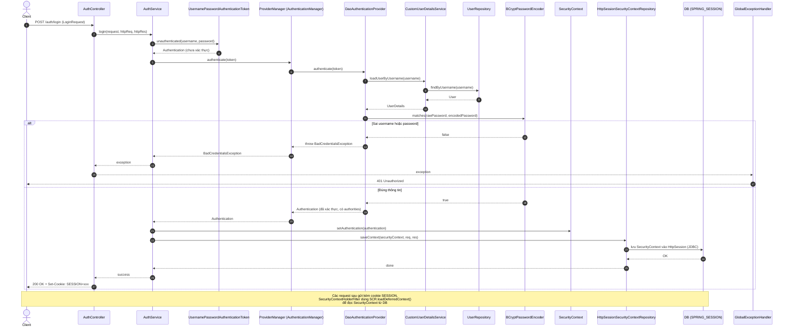

Mình đưa 2 sơ đồ: **class diagram** (quan hệ giữa các thành phần) và **sequence diagram** (luồng login và lưu session vào DB).

## 1. Class diagram

```mermaid
classDiagram
    direction TB

    class GlobalExceptionHandler {
        <<ControllerAdvice>>
        +handleBadCredentials(BadCredentialsException) ResponseEntity
        +handleAuthentication(AuthenticationException) ResponseEntity
    }

    class AuthController {
        <<RestController>>
        +login(LoginRequest, HttpServletRequest, HttpServletResponse) ResponseEntity
    }

    class LoginRequest {
        <<record>>
        +String username
        +String password
    }

    class AuthService {
        <<Service>>
        -AuthenticationManager authenticationManager
        -SecurityContextRepository securityContextRepository
        +login(LoginRequest, HttpServletRequest, HttpServletResponse) void
    }

    class AuthenticationManager {
        <<interface>>
        +authenticate(Authentication) Authentication
    }

    class ProviderManager {
        -List~AuthenticationProvider~ providers
        +authenticate(Authentication) Authentication
    }

    class DaoAuthenticationProvider {
        -UserDetailsService userDetailsService
        -PasswordEncoder passwordEncoder
        +authenticate(Authentication) Authentication
    }

    class UserDetailsService {
        <<interface>>
        +loadUserByUsername(String) UserDetails
    }

    class CustomUserDetailsService {
        <<Service>>
        -UserRepository userRepository
        +loadUserByUsername(String) UserDetails
    }

    class UserRepository {
        <<interface>>
        +findByUsername(String) Optional~User~
    }

    class User {
        <<Entity>>
        +Long id
        +String username
        +String password
        +String role
    }

    class PasswordEncoder {
        <<interface>>
        +encode(CharSequence) String
        +matches(CharSequence, String) boolean
    }

    class BCryptPasswordEncoder {
        +encode(CharSequence) String
        +matches(CharSequence, String) boolean
    }

    class Authentication {
        <<interface>>
        +getPrincipal() Object
        +getCredentials() Object
        +getAuthorities() Collection
        +isAuthenticated() boolean
    }

    class UsernamePasswordAuthenticationToken {
        +unauthenticated(principal, credentials) Token
        +authenticated(principal, credentials, authorities) Token
    }

    class SecurityContext {
        <<interface>>
        +getAuthentication() Authentication
        +setAuthentication(Authentication) void
    }

    class SecurityContextRepository {
        <<interface>>
        +loadDeferredContext(HttpServletRequest) Supplier
        +saveContext(SecurityContext, HttpServletRequest, HttpServletResponse) void
    }

    class HttpSessionSecurityContextRepository {
        +saveContext(...) void
    }

    class SpringSessionJDBC {
        <<spring-session-jdbc>>
        SPRING_SESSION
        SPRING_SESSION_ATTRIBUTES
    }

    AuthController --> LoginRequest : nhận
    AuthController --> AuthService : gọi
    GlobalExceptionHandler ..> AuthController : bắt exception

    AuthService --> AuthenticationManager : authenticate()
    AuthService ..> UsernamePasswordAuthenticationToken : tạo token
    AuthService --> SecurityContextRepository : saveContext()
    AuthService ..> SecurityContext : tạo và set Authentication

    ProviderManager ..|> AuthenticationManager
    ProviderManager o-- DaoAuthenticationProvider : delegate

    DaoAuthenticationProvider --> UserDetailsService : load user
    DaoAuthenticationProvider --> PasswordEncoder : matches()

    CustomUserDetailsService ..|> UserDetailsService
    CustomUserDetailsService --> UserRepository
    UserRepository ..> User : truy vấn

    BCryptPasswordEncoder ..|> PasswordEncoder

    UsernamePasswordAuthenticationToken ..|> Authentication
    SecurityContext o-- Authentication

    HttpSessionSecurityContextRepository ..|> SecurityContextRepository
    HttpSessionSecurityContextRepository --> SpringSessionJDBC : HttpSession lưu xuống DB
```



## 2. Sequence diagram (luồng login)



## Lưu ý

- **Tên class chuẩn của Spring**: `DaoAuthenticationManager` → `DaoAuthenticationProvider`, `UserDetailService` → `UserDetailsService`, `BCrypPasswordEncoder` → `BCryptPasswordEncoder`. Mình đã dùng tên chuẩn trong sơ đồ.
- **Session lưu trong DB** cần thêm dependency `spring-session-jdbc` và cấu hình:
  ```properties
  spring.session.store-type=jdbc
  spring.session.jdbc.initialize-schema=always
  ```
- Từ Spring Security 6, bạn phải **tự gọi `saveContext()`** khi login bằng controller/service (như trong sơ đồ), vì nó không còn tự lưu như trước.

Nếu bạn muốn, mình có thể viết thêm code Java mẫu (SecurityConfig, AuthService) khớp với sơ đồ này.
